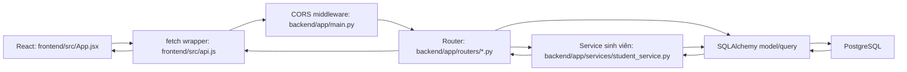

# Dự án quản lý sinh viên

Tài liệu dành cho người mới học backend. Các mô tả dưới đây căn cứ vào mã nguồn hiện tại trong workspace. Khi tài liệu mẫu hoặc kế hoạch khác với code, hãy ưu tiên code.

## Mục lục

1. [Giới thiệu](#gioi-thieu)
2. [Cấu trúc thư mục](#cau-truc-thu-muc)
3. [Luồng hoạt động](#luong-hoat-dong)
4. [Giải thích code backend](#giai-thich-code-backend)
5. [Giải thích code frontend](#giai-thich-code-frontend)
6. [Bảng API và ví dụ curl](#bang-api-va-vi-du-curl)
7. [Các địa chỉ và cổng](#cac-dia-chi-va-cong)
8. [Docker và Docker Compose](#docker-va-docker-compose)
9. [Alembic và migration](#alembic-va-migration)
10. [Lệnh Linux/WSL](#lenh-linuxwsl)
11. [Chạy dự án từ đầu](#chay-du-an-tu-dau)
12. [Lỗi thường gặp](#loi-thuong-gap)
13. [Hướng phát triển tiếp](#huong-phat-trien-tiep)

<a id="gioi-thieu"></a>
## 1. Giới thiệu

Dự án cung cấp API và giao diện web để quản lý lớp học và sinh viên. Backend viết bằng FastAPI, lưu dữ liệu PostgreSQL qua SQLAlchemy; Alembic theo dõi thay đổi cấu trúc bảng; Docker Compose chạy PostgreSQL và backend. Frontend là ứng dụng React chạy bằng Vite, dùng Bootstrap 5 để tạo giao diện.

| Công nghệ | Vai trò trong dự án |
|---|---|
| Python 3.12 | Ngôn ngữ chạy backend; phiên bản nền được khai báo trong `backend/Dockerfile`. |
| FastAPI | Khai báo API, kiểm tra dữ liệu request, tạo Swagger và xử lý dependency. |
| Pydantic | Khai báo schema request/response và ràng buộc dữ liệu. |
| SQLAlchemy | Khai báo model ORM và truy vấn PostgreSQL. |
| PostgreSQL 16 | Cơ sở dữ liệu quan hệ; chạy trong Docker Compose. |
| Psycopg2 | Driver Python để SQLAlchemy kết nối PostgreSQL. |
| Alembic | Tạo và áp dụng migration thay đổi schema database. |
| Docker / Docker Compose | Đóng gói backend và khởi động backend cùng PostgreSQL. |
| React | Xây dựng giao diện sinh viên bằng component và state. |
| Vite | Chạy máy chủ phát triển frontend và build ứng dụng. |
| Bootstrap 5 | Cung cấp CSS component và layout responsive cho giao diện. |

Database có hai bảng chính `classroom` và `student`; `student.classid` là khóa ngoại tới `classroom.classid`. Model hiện tại trong `backend/app/models.py` còn khai báo cột nullable `student.email`. Cột này được thêm bởi migration `backend/alembic/versions/eaba96e02e16_add_student_email.py`, nhưng các schema trong `backend/app/schemas.py` chưa nhận hoặc trả `email`, nên frontend/API hiện không quản lý trường đó.

<a id="cau-truc-thu-muc"></a>
## 2. Cấu trúc thư mục

Cây dưới đây liệt kê mã nguồn và cấu hình dự án; không bung nội dung thư viện cài đặt như `frontend/node_modules/`, môi trường Python cục bộ `.venv/`, `.venv-1/` hay các thư mục cache `__pycache__/`.

```text
.
├── README.md                                      # Tài liệu này
├── Kế hoạch học FastAPI Quản lý sinh viên (CRUD).md # Kế hoạch học ban đầu
├── run.md                                         # Ghi chú ngắn để khởi động dự án
├── docker-compose.yml                             # Định nghĩa database và backend
├── backend/
│   ├── Dockerfile                                 # Cách build image backend
│   ├── requirements.txt                           # Thư viện Python
│   ├── alembic.ini                                # Cấu hình Alembic
│   ├── alembic/
│   │   ├── README                                  # README mẫu do Alembic tạo
│   │   ├── env.py                                  # Nạp model và cấu hình chạy migration
│   │   ├── script.py.mako                          # Mẫu sinh file migration
│   │   └── versions/
│   │       ├── 700136fff3c5_init.py                # Tạo bảng classroom và student
│   │       └── eaba96e02e16_add_student_email.py   # Thêm/bỏ cột student.email
│   └── app/
│       ├── __init__.py                             # Đánh dấu app là package Python
│       ├── database.py                             # Engine, Session và dependency DB
│       ├── errors.py                               # Các lỗi nghiệp vụ và HTTP status
│       ├── main.py                                 # Tạo FastAPI app, CORS và đăng ký router
│       ├── models.py                               # Model SQLAlchemy cho hai bảng
│       ├── schemas.py                              # Schema Pydantic request/response
│       ├── routers/
│       │   ├── __init__.py                         # Package router
│       │   ├── classrooms.py                       # API CRUD lớp học
│       │   └── students.py                         # API CRUD sinh viên
│       └── services/
│           ├── __init__.py                         # Package service
│           └── student_service.py                  # Nghiệp vụ CRUD sinh viên
└── frontend/
    ├── index.html                                  # HTML gốc của trang React
    ├── README.md                                   # README mặc định từ template React/Vite
    ├── package.json                                # Dependencies và scripts npm
    ├── package-lock.json                           # Phiên bản dependencies đã khóa
    ├── vite.config.js                              # Cấu hình plugin React cho Vite
    ├── public/
    │   ├── favicon.svg                             # Favicon
    │   └── icons.svg                               # Bộ SVG icon tĩnh
    └── src/
        ├── api.js                                  # Các hàm gọi HTTP tới backend
        ├── App.jsx                                 # Quản lý state và điều phối component
        ├── App.css                                 # CSS bổ sung cho App
        ├── index.css                               # CSS nền toàn trang
        ├── main.jsx                                # Khởi tạo React và nạp Bootstrap
        ├── components/
        │   ├── StudentForm.jsx                     # Form thêm và sửa sinh viên
        │   └── StudentTable.jsx                    # Bộ lọc và bảng danh sách sinh viên
        └── assets/
            ├── hero.png                            # Ảnh tĩnh trong assets
            ├── react.svg                            # SVG React trong assets
            └── vite.svg                             # SVG Vite trong assets
```

<a id="luong-hoat-dong"></a>
## 3. Luồng hoạt động



Đối với API lớp học, router trong `backend/app/routers/classrooms.py` truy vấn SQLAlchemy trực tiếp; hiện chưa có `classroom_service.py`. API sinh viên đi qua service trong `backend/app/services/student_service.py`.

### Ví dụ: thêm một sinh viên

1. Người dùng điền họ tên, lớp và GPA rồi gửi form trong `frontend/src/App.jsx`.
2. `handleSubmit` tạo payload JSON và gọi `api.createStudent` trong `frontend/src/api.js`.
3. `fetch` gửi `POST http://localhost:8000/students`. Trình duyệt gửi request từ origin frontend; CORS middleware trong `backend/app/main.py` cho phép hai origin `http://localhost:5173` và `http://127.0.0.1:5173`.
4. Router `backend/app/routers/students.py` nhận request, FastAPI kiểm tra bằng `StudentCreate` trong `backend/app/schemas.py`, và `Depends(get_db)` cung cấp một SQLAlchemy session.
5. Router gọi `service.create` trong `backend/app/services/student_service.py`. Service kiểm tra lớp tồn tại, tạo `Student`, `commit()` rồi `refresh()` để lấy dữ liệu đã lưu.
6. SQLAlchemy gửi câu lệnh đến PostgreSQL. Kết quả được FastAPI định dạng theo `StudentOut`; API trả mã `201 Created` và JSON.
7. `frontend/src/api.js` đọc JSON; `frontend/src/App.jsx` tải lại danh sách để cập nhật bảng.

### Ví dụ: xóa lớp còn sinh viên

`DELETE /classrooms/{classid}` được xử lý trực tiếp trong `backend/app/routers/classrooms.py`. Router lấy lớp, kiểm tra quan hệ `obj.students`; nếu lớp còn sinh viên thì ném `HTTPException(status_code=409, ...)`. FastAPI trả `409 Conflict` và không xóa dữ liệu. Trường hợp này không đi qua `AppError` hay service.

<a id="giai-thich-code-backend"></a>
## 4. Giải thích code backend

### `backend/app/database.py` — Kết nối và session database

- `DATABASE_URL = os.getenv('DATABASE_URL')` đọc URL kết nối từ biến môi trường; Compose truyền giá trị này cho container backend.
- `create_engine(DATABASE_URL)` tạo SQLAlchemy engine để quản lý kết nối.
- `SessionLocal = sessionmaker(...)` tạo factory sinh session. `autoflush=False` nghĩa là SQLAlchemy không tự flush trước mỗi query.
- `Base(DeclarativeBase)` là lớp gốc mà các model kế thừa; Alembic dùng `Base.metadata` để đọc cấu trúc bảng.
- `get_db()` tạo session, `yield` session cho request, rồi `finally` đóng session. Vì vậy session vẫn được đóng khi request hoàn tất hoặc phát sinh lỗi.
- Các endpoint khai báo `db: Session = Depends(get_db)` để FastAPI gọi dependency và truyền session vào hàm endpoint.

### `backend/app/models.py` — ORM và quan hệ giữa bảng

- `Classroom.__tablename__ = 'classroom'` ánh xạ lớp Python thành bảng `classroom`.
- `classid` là khóa chính kiểu chuỗi tối đa 20 ký tự; `classname` là chuỗi tối đa 100 ký tự và không nullable.
- `Student.__tablename__ = 'student'`; `id` là khóa chính tự tăng, `name` là tên sinh viên, `gpa` là số thực không nullable và có mặc định ORM `0.0`.
- `Student.classid = mapped_column(ForeignKey('classroom.classid'), nullable=False)` tạo khóa ngoại tới khóa chính lớp. Lớp cần tồn tại trước khi thêm sinh viên.
- `Classroom.students` và `Student.classroom` dùng `relationship(..., back_populates=...)` để truy cập hai phía của quan hệ trong ORM. `obj.students` được router lớp học dùng để chặn xóa lớp đang có sinh viên.
- Model hiện khai báo `Student.email` dạng chuỗi nullable tối đa 100 ký tự. Schema request/response chưa khai báo trường này, nên nó không được cung cấp qua CRUD API hiện tại.

### `backend/app/schemas.py` — Hợp đồng dữ liệu API

- `ClassroomCreate` yêu cầu `classid` dài 1–20 và `classname` dài 1–100.
- `ClassroomUpdate` yêu cầu `classname`; endpoint cập nhật lớp là PUT toàn bộ payload schema này.
- `ClassroomOut` mô tả dữ liệu lớp trả về. `ConfigDict(from_attributes=True)` cho phép Pydantic đọc thuộc tính từ ORM object.
- `StudentCreate` yêu cầu `name`, `classid`, `gpa`; GPA được giới hạn từ 0 đến 4.
- `StudentUpdate` cho phép các trường `name`, `classid`, `gpa` có mặc định `None`, để PATCH có thể gửi một tập con trường. `gpa` nếu có giá trị phải nằm trong 0–4.
- `exclude_unset=True` phân biệt trường bị bỏ qua với trường được gửi rõ ràng là `null`. Tuy nhiên, `name` và `gpa` là cột không nullable trong model; gửi `null` cho các trường này có thể gây lỗi database và hiện chưa có handler chuyển lỗi đó thành status nghiệp vụ.
- `StudentOut` trả `id`, `name`, `classid`, `gpa`; không trả `email`.
- Schema kiểm tra hình dạng và giới hạn dữ liệu. Việc `classid` có tồn tại hay không được service sinh viên hoặc router lớp học kiểm tra riêng.

### `backend/app/errors.py` — Lỗi nghiệp vụ

- `AppError` giữ thông điệp `message` và mặc định mã HTTP `400`.
- `NotFoundError` kế thừa `AppError`, đặt mã `404`; service dùng khi không tìm thấy sinh viên.
- `ConflictError` kế thừa `AppError`, đặt mã `409`, nhưng code hiện tại chưa sử dụng lớp này. Router lớp học ném `HTTPException` trực tiếp cho lỗi 409.
- Handler trong `backend/app/main.py` đổi `AppError` thành JSON `{"detail": ...}` với status tương ứng.

### `backend/app/services/__init__.py`

File rỗng, chỉ giúp Python nhận diện thư mục `services` là package. Logic nghiệp vụ nằm trong `backend/app/services/student_service.py`.

### `backend/app/services/student_service.py` — Nghiệp vụ sinh viên

- `_check_class_exists(db, classid)` dùng `db.get` tìm lớp; nếu không có thì ném `AppError`, trở thành HTTP 400 qua handler.
- `get(db, student_id)` tìm sinh viên theo khóa chính; không thấy thì ném `NotFoundError` (404).
- `create(db, data)` kiểm tra lớp, tạo ORM object từ `data.model_dump()`, sau đó `add`, `commit`, `refresh`.
- `list_all(db, classid, skip, limit)` tạo `select`, sắp theo `id`, thêm điều kiện lớp nếu có, rồi áp dụng `offset` và `limit`.
- `update(db, student_id, data)` lấy sinh viên, dùng `data.model_dump(exclude_unset=True)` để chỉ cập nhật trường client đã gửi; trường vắng mặt không bị ghi đè. Nếu request có `classid`, service xác nhận lớp đó tồn tại trước khi cập nhật.
- `delete(db, student_id)` lấy đối tượng (404 nếu thiếu), xóa và commit.

### `backend/app/routers/__init__.py`

File rỗng đánh dấu package `routers`. Router được import rõ ràng từ `backend/app/main.py`.

### `backend/app/routers/classrooms.py` — API lớp học

- `APIRouter(prefix='/classrooms', tags=['classrooms'])` thêm tiền tố URL và nhóm endpoint trong Swagger.
- Mỗi hàm nhận session bằng `Depends(get_db)`.
- `create_classroom` kiểm tra mã lớp trùng (409), tạo và commit, trả `ClassroomOut` với mã 201.
- `list_classrooms` lấy danh sách và sắp theo `classid`.
- `get_classroom` lấy một lớp; không có thì 404.
- `update_classroom` nhận PUT, cập nhật `classname`, commit và trả object; không có lớp thì 404.
- `delete_classroom` trả 404 nếu không tìm thấy, 409 nếu `obj.students` không rỗng, nếu không thì xóa. Status thành công khai báo là 204 (không có nội dung trả về).
- `response_model` ở các endpoint đọc/ghi quy định schema kết quả, lọc dữ liệu trả về và giúp sinh OpenAPI.

### `backend/app/routers/students.py` — API sinh viên

- Router có tiền tố `/students`; endpoint CRUD gọi các hàm trong `backend/app/services/student_service.py`.
- `create_student` nhận `StudentCreate`, trả `StudentOut`, status tạo mới là 201.
- `list_students` nhận query `classid` tùy chọn, `skip` mặc định 0 (không âm), `limit` mặc định 20 (từ 1 đến 100).
- `get_student` lấy một sinh viên theo `student_id`.
- `update_student` dùng PATCH và schema `StudentUpdate`.
- `delete_student` gọi service xóa và trả 204.
- `response_model` báo FastAPI schema response. Nếu đầu vào sai kiểu hoặc vi phạm giới hạn Pydantic, FastAPI trả 422.

### `backend/app/main.py` — Điểm khởi tạo ứng dụng

- `app = FastAPI(title=...)` tạo ứng dụng FastAPI và đặt tiêu đề Swagger.
- `CORSMiddleware` chỉ cho phép origin frontend localhost ở cổng 5173 (hai cách viết `localhost` và `127.0.0.1`); methods và headers đang để `'*'`.
- `@app.exception_handler(AppError)` bắt các lỗi nghiệp vụ kế thừa `AppError`, trả status và JSON có trường `detail`. `HTTPException` trong router được FastAPI xử lý theo cơ chế riêng.
- `app.include_router(...)` đăng ký router lớp học và sinh viên.
- `/health` trả trạng thái app. `/health/db` nhận session qua `Depends(get_db)` và chạy `SELECT 1`.
- File hiện tại **không** gọi `Base.metadata.create_all()` và không chạy migration tự động khi khởi động. Cần áp dụng migration trước khi gọi API cần bảng.

<a id="giai-thich-code-frontend"></a>
## 5. Giải thích code frontend

### `frontend/src/api.js` — Gọi backend

- `BASE_URL` lấy từ `VITE_API_URL`; nếu biến này không được đặt thì dùng `http://localhost:8000`.
- `request(path, options)` gọi `fetch`, gắn `Content-Type: application/json`, kiểm tra `response.ok`.
- Khi API trả lỗi, hàm ưu tiên đọc `detail` chuỗi; nếu là danh sách lỗi Pydantic thì ghép trường `msg`; nếu body không đọc được thì dùng status text hoặc thông báo có status.
- Với status 204, hàm trả `null` vì response không có JSON.
- Object `api` cung cấp các hàm tải lớp, tải/lọc sinh viên và tạo/cập nhật/xóa sinh viên. `URLSearchParams` mã hóa query `classid`.

### `frontend/src/App.jsx` — Điều phối trang CRUD sinh viên

- State `classes` và `students` giữ dữ liệu lớp/sinh viên. `filter` giữ lớp đang lọc.
- `form` lưu giá trị form; `editingId` là `null` khi thêm và là ID khi sửa.
- `error`, `loading`, `submitting` lần lượt điều khiển thông báo lỗi, trạng thái tải danh sách, và trạng thái nút lưu.
- `useEffect` đầu tiên tải lớp một lần khi component mở. `useEffect` thứ hai tải sinh viên mỗi khi `filter` đổi; biến `active` tránh cập nhật state sau khi effect đã bị hủy.
- `loadStudents` tải lại danh sách hiện tại sau khi tạo/sửa/xóa.
- `handleSubmit` ngăn submit HTML mặc định, đổi GPA thành số, chọn POST hoặc PATCH dựa trên `editingId`, reset form khi thành công và tải lại danh sách. Lỗi API hiện trong alert.
- `handleEdit` chép dữ liệu hàng đang chọn vào form để chỉnh sửa.
- `handleDelete` hỏi xác nhận bằng `window.confirm`, gọi API xóa và tải lại danh sách.
- JSX kết hợp component giao diện, giữ state và xử lý nghiệp vụ ở trang cha.

### `frontend/src/components/StudentForm.jsx` — Form sinh viên

- Nhận dữ liệu form, danh sách lớp và trạng thái thêm/sửa qua props.
- Vẽ các input họ tên, lớp và GPA cùng nút lưu; `onChange`, `onSubmit` và `onCancel` báo thao tác về `App.jsx`.
- Không gọi API và không giữ state nghiệp vụ riêng; cùng một form dùng được khi tạo hoặc sửa.

### `frontend/src/components/StudentTable.jsx` — Bộ lọc và bảng

- Nhận danh sách lớp/sinh viên, trạng thái tải và các callback từ `App.jsx`.
- Hiển thị bộ lọc lớp, trạng thái đang tải/danh sách trống và từng hàng sinh viên.
- Báo sự kiện lọc, sửa hoặc xóa lên component cha; không gọi API trực tiếp.

### `frontend/src/main.jsx` và CSS

- `frontend/src/main.jsx` nạp CSS Bootstrap, `frontend/src/index.css`, rồi mount `App` bên trong `StrictMode`.
- `frontend/src/App.css` bổ sung màu nền, navbar, kích thước bộ lọc và kiểu tiêu đề bảng.
- `frontend/index.html` đặt ngôn ngữ trang là `vi` và tiêu đề “Quản lý sinh viên”.
- `frontend/vite.config.js` đăng ký plugin React cho Vite.

<a id="bang-api-va-vi-du-curl"></a>
## 6. Bảng API và ví dụ curl

URL bên dưới giả sử backend đang chạy ở `http://localhost:8000`.

| Phương thức | URL đầy đủ | Mô tả | Body hoặc query param | Mã trạng thái có thể trả về |
|---|---|---|---|---|
| POST | `http://localhost:8000/classrooms` | Tạo lớp | JSON `{"classid":"CNTT01","classname":"Công nghệ thông tin 01"}` | 201, 409 mã lớp trùng, 422 dữ liệu sai |
| GET | `http://localhost:8000/classrooms` | Liệt kê lớp | Không có | 200 |
| GET | `http://localhost:8000/classrooms/{classid}` | Lấy một lớp | `classid` trên URL | 200, 404 |
| PUT | `http://localhost:8000/classrooms/{classid}` | Đổi tên lớp | JSON `{"classname":"Tên lớp mới"}` | 200, 404, 422 |
| DELETE | `http://localhost:8000/classrooms/{classid}` | Xóa lớp không có sinh viên | `classid` trên URL | 204, 404, 409 lớp còn sinh viên |
| POST | `http://localhost:8000/students` | Tạo sinh viên | JSON `{"name":"Nguyễn Văn A","classid":"CNTT01","gpa":3.2}` | 201, 400 lớp không tồn tại, 422 dữ liệu sai |
| GET | `http://localhost:8000/students` | Liệt kê sinh viên | Query tùy chọn `classid`, `skip` (mặc định 0), `limit` (mặc định 20, tối đa 100) | 200, 422 query sai |
| GET | `http://localhost:8000/students/{student_id}` | Lấy một sinh viên | `student_id` số nguyên trên URL | 200, 404, 422 ID sai kiểu |
| PATCH | `http://localhost:8000/students/{student_id}` | Cập nhật các trường sinh viên được gửi | Ví dụ JSON `{"gpa":3.8}` | 200, 400 lớp không tồn tại, 404, 422; có thể 500 nếu gửi `null` cho cột không nullable |
| DELETE | `http://localhost:8000/students/{student_id}` | Xóa sinh viên | `student_id` trên URL | 204, 404, 422 ID sai kiểu |
| GET | `http://localhost:8000/health` | Kiểm tra API đang phản hồi | Không có | 200 |
| GET | `http://localhost:8000/health/db` | Kiểm tra kết nối database bằng `SELECT 1` | Không có | 200 nếu kết nối thành công; có thể 500 nếu DB lỗi |

Mã có thể phụ thuộc vào đầu vào: FastAPI/Pydantic tự trả 422 khi request không hợp lệ; các status do code chủ động ném được ghi ở trên. Lỗi database ngoài dự kiến có thể trả 500.

### Ý nghĩa phương thức HTTP

| Phương thức | Ý nghĩa trong dự án |
|---|---|
| GET | Đọc danh sách hoặc một bản ghi; không chủ ý sửa dữ liệu. |
| POST | Tạo một bản ghi mới. |
| PUT | Thay thông tin lớp bằng payload `ClassroomUpdate` hiện yêu cầu `classname`. |
| PATCH | Cập nhật một phần trường sinh viên đã gửi. |
| DELETE | Xóa bản ghi; khi thành công các endpoint xóa trả 204. |

### Ý nghĩa mã trạng thái

| Mã | Ý nghĩa |
|---|---|
| 200 | Request thành công và thường có dữ liệu trả về. |
| 201 | Đã tạo bản ghi mới. |
| 204 | Thao tác thành công nhưng không có response body, dùng cho DELETE. |
| 400 | Dữ liệu nghiệp vụ không hợp lệ; ví dụ service sinh viên không tìm thấy lớp được tham chiếu. |
| 404 | Không tìm thấy bản ghi theo ID/mã lớp. |
| 409 | Xung đột; ví dụ mã lớp đã tồn tại hoặc lớp vẫn còn sinh viên. |
| 422 | Request không qua kiểm tra kiểu/giới hạn của FastAPI/Pydantic, hoặc path parameter không đúng kiểu. |
| 500 | Lỗi máy chủ ngoài dự kiến, ví dụ kết nối database thất bại. |

### Ví dụ curl theo nhóm endpoint

Các ví dụ dùng JSON và địa chỉ localhost. Tạo lớp trước khi tạo sinh viên:

```bash
# Classroom: tạo, liệt kê, đọc, đổi tên, xóa
curl -i -X POST http://localhost:8000/classrooms \
  -H 'Content-Type: application/json' \
  -d '{"classid":"CNTT01","classname":"Công nghệ thông tin 01"}'

curl -i http://localhost:8000/classrooms
curl -i http://localhost:8000/classrooms/CNTT01

curl -i -X PUT http://localhost:8000/classrooms/CNTT01 \
  -H 'Content-Type: application/json' \
  -d '{"classname":"Công nghệ thông tin"}'

# Chỉ xóa thành công nếu lớp không còn sinh viên
curl -i -X DELETE http://localhost:8000/classrooms/CNTT01
```

```bash
# Student: tạo, liệt kê, lọc, đọc, cập nhật, xóa
curl -i -X POST http://localhost:8000/students \
  -H 'Content-Type: application/json' \
  -d '{"name":"Nguyễn Văn A","classid":"CNTT01","gpa":3.2}'

curl -i 'http://localhost:8000/students?skip=0&limit=20'
curl -i 'http://localhost:8000/students?classid=CNTT01'
curl -i http://localhost:8000/students/1

curl -i -X PATCH http://localhost:8000/students/1 \
  -H 'Content-Type: application/json' \
  -d '{"gpa":3.8}'

curl -i -X DELETE http://localhost:8000/students/1
```

```bash
# Kiểm tra app và database
curl -i http://localhost:8000/health
curl -i http://localhost:8000/health/db
```

`-i` hiển thị cả header và status HTTP. Xem thêm giải thích các cờ curl ở mục [Lệnh Linux/WSL](#lenh-linuxwsl).

<a id="cac-dia-chi-va-cong"></a>
## 7. Các địa chỉ và cổng

| Địa chỉ/cổng | Dùng để làm gì |
|---|---|
| `http://localhost:8000/docs` | Swagger UI do FastAPI sinh tự động; thử endpoint và xem schema. |
| `http://localhost:8000/health` | Kiểm tra API đang phản hồi. |
| `http://localhost:8000/health/db` | Kiểm tra API có truy vấn được PostgreSQL. |
| `http://localhost:5173` | Giao diện React do Vite phục vụ khi chạy máy phát triển. |
| `localhost:5432` | Cổng PostgreSQL được publish ra máy host bởi `docker-compose.yml`; dùng cho client DB trên máy host. Backend trong container không dùng địa chỉ này để tìm DB. |

<a id="docker-va-docker-compose"></a>
## 8. Docker và Docker Compose

### `backend/Dockerfile` từng dòng

```dockerfile
FROM python:3.12-slim
WORKDIR /app
COPY requirements.txt .
RUN pip install --no-cache-dir -r requirements.txt
COPY . .
```

- `FROM` chọn image Python 3.12 slim làm nền.
- `WORKDIR /app` đặt thư mục làm việc trong image.
- `COPY requirements.txt .` chép danh sách thư viện vào image.
- `RUN pip install ...` cài các package; `--no-cache-dir` không lưu cache pip trong image.
- `COPY . .` chép nội dung thư mục `backend/` vào `/app`. Vì build context trong Compose là `./backend`, các đường dẫn nguồn ở đây tương đối với thư mục đó.

### `docker-compose.yml` từng khối

- `services.db.image: postgres:16`: chạy PostgreSQL 16.
- `environment`: `POSTGRES_USER`, `POSTGRES_PASSWORD`, `POSTGRES_DB` khởi tạo tài khoản và database khi volume được tạo lần đầu. **Các giá trị mật khẩu trong file Compose chỉ dành cho phát triển; không dùng khi triển khai thật.**
- `ports: "5432:5432"`: ánh xạ cổng 5432 của máy host vào cổng 5432 của container DB.
- `volumes: pgdata:/var/lib/postgresql/data`: lưu database trong named volume để dữ liệu còn sau khi container dừng hoặc được tạo lại.
- `healthcheck`: `pg_isready` kiểm tra database; chạy mỗi 5 giây, timeout 5 giây, thử tối đa 5 lần.
- `services.backend.build: ./backend`: build backend từ `backend/Dockerfile`.
- `ports: "8000:8000"`: publish FastAPI ra máy host ở cổng 8000.
- `environment.DATABASE_URL`: truyền URL SQLAlchemy/PostgreSQL vào backend.
- `volumes: ./backend:/app`: bind mount source backend vào container; thay đổi code được phản ánh trong container.
- `depends_on.condition: service_healthy`: yêu cầu DB vượt qua healthcheck trước khi khởi động backend.
- `command`: chạy Uvicorn trên `0.0.0.0:8000`; `--reload` tự tải lại khi source thay đổi.
- Khối `volumes.pgdata` khai báo named volume database.

### Vì sao hostname là `db`?

Trong mạng Compose, service có tên `db` được phân giải bằng DNS nội bộ của Compose. Vì vậy backend dùng hostname `db`. `localhost` bên trong container backend chỉ trỏ về chính container backend, không phải container PostgreSQL. `localhost:5432` chỉ là đường truy cập từ máy host qua cổng đã publish.

### Vì sao URL có `+psycopg2`?

`postgresql+psycopg2://...` là cú pháp SQLAlchemy: `postgresql` chọn dialect PostgreSQL, `psycopg2` chọn driver Python cụ thể. Driver được cài bởi package `psycopg2-binary` trong `backend/requirements.txt`.

### Lệnh Docker Compose

Chạy các lệnh tại thư mục gốc, nơi có `docker-compose.yml`.

| Lệnh | Ý nghĩa và khi dùng |
|---|---|
| `docker compose up --build` | Build image nếu cần và chạy foreground; dùng khi muốn xem log trực tiếp hoặc vừa đổi Dockerfile/dependency. |
| `docker compose up -d` | Khởi động ở chế độ nền. |
| `docker compose up -d --build` | Build lại rồi chạy nền; dùng sau khi đổi dependency/Dockerfile. |
| `docker compose ps` | Xem trạng thái và cổng container. |
| `docker compose logs -f backend` | Theo dõi log backend; nhấn Ctrl+C để dừng theo dõi, không dừng container. |
| `docker compose exec backend alembic upgrade head` | Chạy lệnh Alembic bên trong container backend đang chạy. |
| `docker compose exec backend bash` | Mở shell trong container backend để kiểm tra thủ công. |
| `docker compose exec db psql -U admin -d student_db` | Mở PostgreSQL client trong container DB. |
| `docker compose down` | Dừng và xóa container/network của Compose, giữ named volume `pgdata`. |
| `docker compose down -v` | Dừng và xóa cả named volume; **xóa dữ liệu database**, chỉ dùng khi chủ ý reset. |

<a id="alembic-va-migration"></a>
## 9. Alembic và migration

Migration là lịch sử các thay đổi cấu trúc database. Thay vì tạo bảng tự động mỗi lần app chạy, Alembic áp dụng các revision theo thứ tự và lưu revision hiện tại trong bảng `alembic_version`. `backend/app/main.py` hiện không tự chạy migration.

### File Alembic hiện có

- `backend/alembic.ini`: chỉ định `script_location = %(here)s/alembic`, cấu hình logging, và có URL placeholder `driver://...`.
- `backend/alembic/env.py`: import `app.models` để đăng ký metadata; lấy URL thật từ `os.environ['DATABASE_URL']`, ghi đè URL trong config; đặt `target_metadata = Base.metadata` để `--autogenerate` so sánh model với schema.
- `backend/alembic/script.py.mako`: mẫu mà Alembic dùng để sinh revision.
- `backend/alembic/versions/700136fff3c5_init.py`: revision đầu tiên, tạo `classroom` và `student`; downgrade bỏ hai bảng.
- `backend/alembic/versions/eaba96e02e16_add_student_email.py`: revision kế tiếp, thêm nullable `student.email`; downgrade bỏ cột đó.
- `backend/alembic/README`: ghi chú mẫu do lệnh Alembic tạo.

Vì `env.py` yêu cầu biến `DATABASE_URL`, các lệnh dưới đây chạy bằng `docker compose exec backend`, nơi Compose đã đặt biến đó.

### Áp dụng migration hiện tại lần đầu

```bash
docker compose up -d --build
docker compose exec backend alembic upgrade head
```

`upgrade head` áp dụng các revision chưa chạy, từ tạo bảng tới thêm `email`. Xem revision và bảng bằng:

```bash
docker compose exec backend alembic current
docker compose exec db psql -U admin -d student_db -c '\dt'
```

### Quy trình khi đổi cấu trúc bảng

1. Sửa model trong `backend/app/models.py`.
2. Tạo revision tự động trong container backend:

   ```bash
   docker compose exec backend alembic revision --autogenerate -m 'ten_thay_doi'
   ```

3. Mở file mới trong `backend/alembic/versions/` để đọc và kiểm tra `upgrade()` lẫn `downgrade()`. Autogenerate có thể cần chỉnh tay.
4. Áp dụng revision:

   ```bash
   docker compose exec backend alembic upgrade head
   ```

5. Nếu cần quay lại revision trước:

   ```bash
   docker compose exec backend alembic downgrade -1
   ```

   `-1` hoàn tác một revision. Ví dụ trong code hiện tại, downgrade revision mới nhất sẽ bỏ cột `student.email`; model vẫn khai báo cột đó, nên không tiếp tục dùng app với schema/model lệch nhau. Hãy nâng lại `head` hoặc đồng bộ model và database trước.

Nếu database cũ được tạo thủ công bằng `create_all`, không xóa volume theo thói quen. Cần quyết định cách chuyển dữ liệu trước; `docker compose down -v` sẽ xóa database.

<a id="lenh-linuxwsl"></a>
## 10. Lệnh Linux/WSL

Các lệnh bên dưới phục vụ tạo, chạy và kiểm tra dự án. Một số lệnh là tiện ích chung; lịch sử terminal đầy đủ không được lưu trong repository.

| Lệnh | Ý nghĩa | Ví dụ |
|---|---|---|
| `mkdir -p` | Tạo thư mục và các thư mục cha nếu chưa có. | `mkdir -p ~/student-management/backend/app` |
| `cd` | Chuyển thư mục hiện tại. | `cd ~/student-management` |
| `pwd` | In đường dẫn thư mục hiện tại. | `pwd` |
| `ls -la` | Liệt kê cả file ẩn, kèm quyền và thông tin file. | `ls -la` |
| `touch` | Tạo file rỗng nếu chưa có. | `touch backend/app/__init__.py` |
| `cat` | In nội dung file ra terminal. | `cat backend/requirements.txt` |
| `grep` | Tìm chuỗi trong file. | `grep -n "DATABASE_URL" docker-compose.yml` |
| `chown` | Đổi chủ sở hữu file/thư mục; chỉ dùng khi quyền sở hữu thực sự sai. | `sudo chown -R "$USER":"$USER" backend` |
| `sudo` | Chạy lệnh với quyền quản trị. Chỉ dùng khi cần và hiểu tác động. | `sudo apt update` |
| `source` | Nạp script vào shell hiện tại, ví dụ kích hoạt virtualenv hoặc nạp cấu hình shell. | `source .venv/bin/activate` |
| `export` | Đặt biến môi trường cho tiến trình con trong shell hiện tại. | `export DATABASE_URL='postgresql+psycopg2://...'` |
| `code .` | Mở thư mục hiện tại trong VS Code nếu lệnh `code` đã được cài cho WSL. | `code .` |
| `node --version` | Xem phiên bản Node.js. | `node --version` |
| `nvm` | Quản lý nhiều phiên bản Node.js; cài NVM trước khi gọi lệnh nếu chưa có. | `nvm install --lts` |
| `npm create vite@latest` | Tạo project Vite; trong workspace hiện có `frontend/`, không cần chạy lại lệnh tạo này. | `npm create vite@latest frontend -- --template react` |
| `npm install` | Cài các dependency được liệt kê trong `package.json`/lockfile của thư mục frontend. | `cd frontend && npm install` |
| `npm run dev` | Chạy Vite development server. | `cd frontend && npm run dev` |
| Ctrl+C | Ngắt tiến trình foreground trong terminal, ví dụ Vite hoặc `docker compose up` không chạy nền. | Nhấn `Ctrl` và `C` cùng lúc |

### Các cờ curl thường dùng

| Cờ | Ý nghĩa | Ví dụ |
|---|---|---|
| `-i` | Hiển thị response headers cùng nội dung. | `curl -i http://localhost:8000/health` |
| `-X` | Chỉ định HTTP method. | `curl -X DELETE http://localhost:8000/students/1` |
| `-H` | Thêm HTTP header. | `-H 'Content-Type: application/json'` |
| `-d` | Gửi request body; với JSON nên đi kèm header JSON. | `-d '{"name":"An","classid":"CNTT01","gpa":3.2}'` |
| `-s` | Chế độ yên lặng, ẩn progress/error mặc định của curl. | `curl -s http://localhost:8000/health` |
| `-o` | Ghi response body vào file hoặc `/dev/null`. | `curl -o /dev/null http://localhost:8000/health` |
| `-w` | In thông tin theo format sau request, ví dụ HTTP status. | `curl -s -o /dev/null -w '%{http_code}\n' http://localhost:8000/health` |

### Ghi chú WSL

Trong WSL Ubuntu, thường nên đặt project dưới `~/student-management` thay vì `/mnt/c/...`. Thư mục Linux thường cho thao tác file và file watcher nhanh, ổn định hơn với công cụ Node, Python, Docker bind mount. Mở đúng VS Code remote WSL để terminal và interpreter dùng môi trường Linux.

<a id="chay-du-an-tu-dau"></a>
## 11. Chạy dự án từ đầu

### Yêu cầu

- WSL 2 với Ubuntu và VS Code có hỗ trợ WSL.
- Docker Desktop đang chạy và đã bật tích hợp WSL cho distro Ubuntu, hoặc Docker Engine hoạt động trong WSL.
- Node.js/NPM để chạy Vite. Kiểm tra bằng `node --version` và `npm --version`.
- Đảm bảo cổng 5432, 8000 và 5173 không bị chương trình khác chiếm.

### Bước 1: mở workspace

```bash
cd ~/student-management
code .
```

### Bước 2: chạy PostgreSQL và backend

```bash
docker compose up -d --build
docker compose ps
```

Chờ service `db` healthy và backend đang chạy. Compose chỉ khởi động container; ứng dụng hiện không tạo schema tự động.

### Bước 3: tạo/cập nhật bảng bằng Alembic

```bash
docker compose exec backend alembic upgrade head
```

Lệnh này chạy các migration trong `backend/alembic/versions/`. Database cần có bảng trước khi các endpoint CRUD hoạt động.

### Bước 4: chạy frontend

Mở terminal WSL khác:

```bash
cd ~/student-management/frontend
npm install
npm run dev -- --host 0.0.0.0
```

Mở `http://localhost:5173`. `frontend/src/api.js` mặc định gọi API ở `http://localhost:8000`.

### Bước 5: kiểm tra

```bash
curl -i http://localhost:8000/health
curl -i http://localhost:8000/health/db
```

Mở Swagger tại `http://localhost:8000/docs`, giao diện tại `http://localhost:5173`. Để kiểm tra CRUD, tạo lớp trước tại Swagger hoặc bằng lệnh curl ở mục 6, rồi tạo sinh viên thuộc lớp đó.

### Tắt dịch vụ

- Dừng Vite bằng `Ctrl+C` trong terminal Vite.
- Dừng container và giữ nguyên dữ liệu PostgreSQL:

  ```bash
  cd ~/student-management
  docker compose down
  ```

- Chỉ khi chủ ý xóa dữ liệu database mới chạy `docker compose down -v`.

<a id="loi-thuong-gap"></a>
## 12. Lỗi thường gặp

| Lỗi/triệu chứng | Nguyên nhân thường gặp | Cách xử lý |
|---|---|---|
| Docker báo daemon không kết nối hoặc Docker Desktop chưa chạy | Docker Desktop chưa mở, hoặc WSL integration chưa bật. | Mở Docker Desktop, bật tích hợp WSL cho Ubuntu rồi chạy `docker compose ps` và thử lại. |
| `ModuleNotFoundError: No module named 'psycopg2'` | Driver chưa được cài trong môi trường backend đang chạy. | `backend/requirements.txt` khai báo `psycopg2-binary`; build lại image bằng `docker compose up -d --build`, rồi xem `docker compose logs -f backend`. Không nhầm tên package cài đặt `psycopg2-binary` với module import `psycopg2`. |
| `IndentationError` | Thụt lề Python không nhất quán hoặc có dòng đặt sai block. | Mở file và dòng được traceback chỉ ra; dùng thụt lề 4 spaces nhất quán, lưu rồi xem log backend. |
| `ImportError` khi import router hoặc báo không tìm thấy module | File/package chưa tồn tại, tên import sai, hoặc đang chạy sai thư mục/module. | Xác nhận `backend/app/routers/__init__.py`, `backend/app/routers/classrooms.py`, `backend/app/routers/students.py` tồn tại; chạy Compose từ thư mục gốc và kiểm tra `docker compose logs backend`. |
| Bảng API báo lỗi CORS trong browser Console | Origin frontend không thuộc danh sách cho phép, thường do dùng cổng/host khác. | `backend/app/main.py` hiện cho phép `http://localhost:5173` và `http://127.0.0.1:5173`; mở frontend tại một trong hai origin này, kiểm tra backend chạy ở cổng 8000. |
| `port 5432 is already allocated` | PostgreSQL khác đang chiếm cổng máy host. | Dừng dịch vụ chiếm cổng hoặc đổi phía host trong `docker-compose.yml`, ví dụ `"5433:5432"`; container backend vẫn dùng hostname `db` và cổng nội bộ 5432. |
| Terminal `psql` hiện `(END)` và tưởng bị treo | Output được mở trong pager như `less`. | Nhấn `q` để thoát. Có thể chạy lại với `PAGER=cat` hoặc tắt pager trong psql bằng `\pset pager off`. |
| Gọi `/students/docs` nhận 422 | `/students/{student_id}` nhận `docs` làm `student_id`, nhưng ID phải là số nguyên. `/docs` là đường dẫn Swagger ở root, không nằm dưới `/students`. | Mở `http://localhost:8000/docs`; dùng `GET /students/{id}` với ID số. |
| Gọi API CRUD báo relation/table không tồn tại | Migrations chưa được áp dụng hoặc đang dùng database mới. | Chạy `docker compose exec backend alembic upgrade head`; kiểm tra `docker compose exec backend alembic current`. |
| Thêm sinh viên trả 400 `classid không tồn tại` | Mã lớp gửi lên chưa có trong bảng `classroom`. | Tạo lớp bằng `POST /classrooms` trước, rồi dùng đúng `classid`. |
| Xóa lớp trả 409 | Lớp còn sinh viên hoặc mã lớp đã tồn tại trong trường hợp tạo lớp. | Với xóa lớp, xóa/chuyển sinh viên trước. Với tạo lớp, chọn mã `classid` chưa được dùng. |
| Frontend báo `Failed to fetch` | Backend không chạy, địa chỉ/cổng API sai, hoặc có vấn đề kết nối/CORS. | Kiểm tra `/health`, `docker compose ps`, URL mặc định trong `frontend/src/api.js`, rồi kiểm tra Console và log backend. |

<a id="huong-phat-trien-tiep"></a>
## 13. Hướng phát triển tiếp

Các mục dưới đây là đề xuất, chưa có trong code hiện tại:

1. **pytest**: viết unit/integration test cho service, router và validation; dùng database test riêng để không đụng dữ liệu phát triển.
2. **`.env` và `.gitignore`**: chuyển thông tin cấu hình ra môi trường local và loại file chứa secret, virtualenv, `node_modules`, cache khỏi version control. Không dùng password hiện tại để triển khai thật.
3. **Đưa frontend vào Compose**: thêm service frontend nếu muốn khởi động cả web và backend bằng một lệnh Compose.
4. **JWT**: thêm đăng nhập, xác thực token và kiểm soát quyền trước khi mở CRUD.
5. **Phân trang có tổng số bản ghi**: bổ sung API trả cả danh sách và tổng số, rồi nối với giao diện phân trang.
6. **Quản lý lớp trên frontend**: hiện frontend chỉ tải lớp để chọn/lọc; CRUD lớp hiện chỉ có API.
7. **Đồng bộ email**: nếu muốn quản lý `student.email`, bổ sung trường vào schema request/response, API và giao diện; hiện model và migration có cột nhưng CRUD API không công khai trường này.
